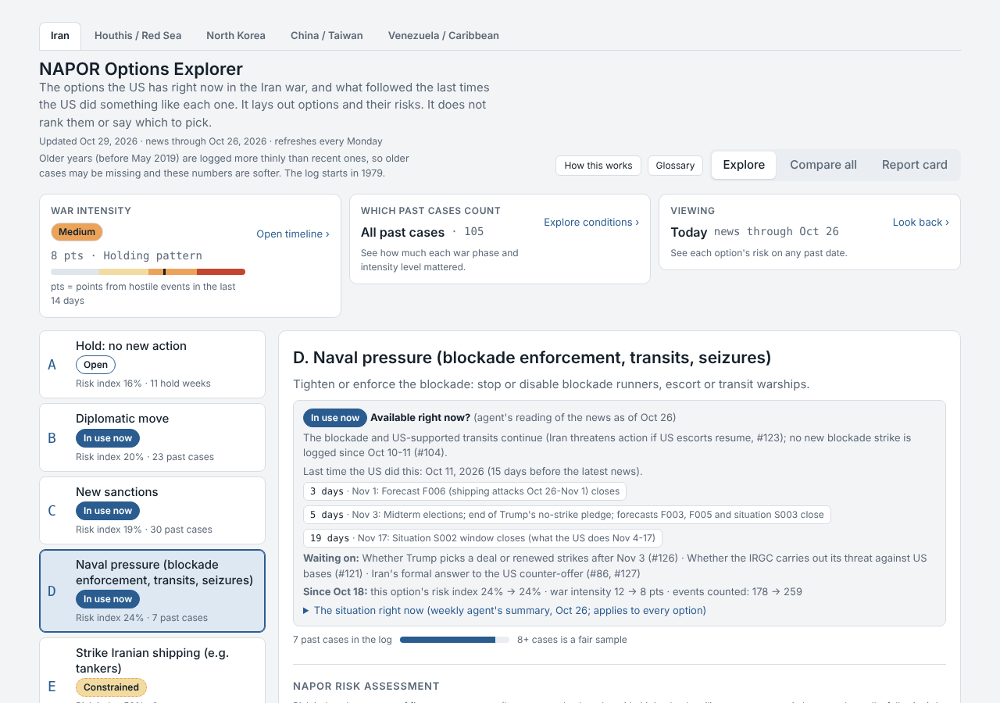

# NAPOR: Options Explorer

An options explorer for the risks behind US national security decisions, built from 1,090+ events across
five conflicts (1979 to 2026) and information pulled from 930+ credible source links.

**Live Explorer: https://siddraw.github.io/NAPOR-Options-Explorer/**

Options Explorer is built on NAPOR, a system that keeps a careful, sourced record of real events and the way events have followed one another, and turns that record into plain counts of what usually happened next. For every US option on the page, Options Explorer asks NAPOR what followed the last times the US did something like it.

**Engine and tool.** NAPOR is the engine. Options Explorer is a tool built on it. NAPOR has no point of view of its own; Options Explorer adds the context, which is the US side, the options, the five kinds of risk and the conflicts. It keeps its own record and never changes the engine. The same engine could power other tools that ask different questions.

For each conflict, the page lists the options the US has and shows what followed the last times the US did
something like each one. **It does not rank the options or pick one.** That is the decision-maker's job.

## Using the page

- **Conflict tabs.** Iran, Houthis / Red Sea, North Korea, China / Taiwan and Venezuela / Caribbean.
- **Explore.** Pick an option (A, B, C and so on) to see its risk index, the five risk categories, and the
  past cases behind every number, each with its sources.
- **Compare all.** Every option side by side for the conflict you are in.
- **Report card.** How earlier forecasts and the risk numbers scored once the outcomes were known.
- **Timeline and conditions.** Open the timeline to see how intense the conflict was over time, and pick a war
  phase or intensity level to count only past cases from that condition.
- **Look back.** View the page as it would have looked on a past date, using only what was known then.
- **How this works and Glossary.** Short explanations inside the page.

### Reading the numbers

Every percentage is "x of n past cases". Next to it is a range, like 14-84%, which is the margin of error:
with only a few cases a rate such as 1 of 3 could easily be off, and the range shows how high or low the true
rate could plausibly be. More cases make the range narrower (1 of 3 gives about 6-79%, 10 of 30 gives about
19-51%). A wide range means the number is a hint, not a conclusion. When an option has fewer than 3 counted
cases the page says "Too few cases" instead of a percentage.

Each option is described with the same five kinds of risk:

1. **People** – someone was hurt, by the US action or by the reply.
2. **Escalation** – the other side struck back within days.
3. **Military** – the reply used missiles, rockets or drones.
4. **Economic Harm** – a market price moved against the US side's interest within 3 days, by at least twice a normal day's move: Brent oil for Iran, the Houthis and Venezuela; the Taiwan dollar for China / Taiwan; the South Korean won for North Korea (price data: FRED, from the EIA and the Federal Reserve).
5. **Political** – no talks, meetings or deals followed within 14 days.

### Your own option

If the US move you have in mind is not on the list, describe it in your own words (and, if you like, fill in
the boxes for type of move, target, location, scale, who acts, and open or covert). The page finds the past US
actions that are the same kind of action, closest first, and counts them with the same five categories.

- Opposites are kept apart: pulling troops out is never matched with sending them in.
- "Not" is understood: "negotiate rather than strike" is read as talks, and "do not strike" is read as the US
  holding back.
- Next to the risk numbers, a "Relevance" figure says how closely the past cases fit what you typed. It says
  how well past cases fit, not how risky the move is, and it never changes a risk number.
- If the log has no past cases like your request, the page says so. With fewer than 3 counted cases it shows
  "Too few cases" instead of an index.
- Your own options appear in Compare all in a block marked as yours. They are saved only in your browser.
  Nothing you type leaves your browser unless you use the optional button that fills the boxes from a
  free-text description.
- If you type a capture or kill operation against a leader ("capture Maduro", "kill the Houthi leader"), a
  small box says how many past leader operations worldwide look like it and names the closest ones. Where
  option I is available in that tab it links to it; otherwise it says option I is not available there.

## Intended use and limits

**Intended use.** To give a clear picture of the risk behind the options the US has with different actors in
different conflicts. For each option the page reports what followed the last times the US did something like
it. Other uses:
- A starting point for students and analysts studying how US moves and adversary replies have played out.
- A way to check a claim like "every time the US strikes, they hit back" against the actual record.
- A record over time: every week is saved, so you can look back at what the options and risks looked like on
  any past date.

**Limits.**
- The news is public, so it may be more limited or censored than what people with higher clearance see.
- The risk percentage is built from five categories, and there may be other kinds of risk that are not
  captured here.
- The data is refreshed every Monday, so updates can be delayed by up to a week.
- Many options rest on a small number of past cases, so read the numbers as hints, not facts.
- "After" is not "because of": a reply that followed a US move was not always caused by it.
- Older years are logged less densely than recent ones, so early history is less complete. The page says so on
  every tab and marks those cases "older, thinner data".

## Conflicts covered

- **Iran** (Nov 1979 on, mostly the 2026 war): the main tab, with forecasts and a decision log. Caveat: older years are logged more thinly.
- **Houthis / Red Sea** (Sep 2014 on): US moves and Houthi replies. Caveat: 2024 was continuous fighting, so few cases count, and the 2025–26 log is thin.
- **North Korea** (Mar 1993 on): US/South Korea moves and North Korean launches. Caveat: the launch log is a sample; economic harm uses the South Korean won.
- **China / Taiwan** (May 1995 on): Taiwan Strait and South China Sea. Caveat: small numbers; option A has no cases.
- **Venezuela / Caribbean** (Feb 1999 on): US moves toward Venezuela and the boat-strike campaign, and Venezuelan or armed-group replies. Caveat: more than 70 boat strikes are known, but the log has only 18 boat-strike rows (some rows cover several strikes); most Venezuelan replies are statements and are not counted as escalation; hold weeks may hide unlogged strikes.

**Option I, "Capture or kill the leader".** A leader capture is not going on most of the time, so it is an option
inside a country tab, shown only where it applies. Today it is available in Iran and the Houthi tab. In North Korea,
China and Venezuela the page shows one muted line with the reason. Its numbers are never the country's own: they come
from past US operations against leaders worldwide, 1983-2026 (137 logged events and 46 counted cases on
2026-11-17). A "Ways to do it" list gives seven sub-options (capture raid; kill strike or raid; indict, reward or
sanction; negotiate the leader's exit; back a partner; extradition or handover; invasion that removes the leader),
each with its own cases, plus the country's own past cases. It is separate from options A-H and never ranks or
recommends.

**Iran notes.**
- Options rest on 3–30 past cases.
- Hold weeks (option A) are mostly quiet weeks with few logged events; an unlogged event would change them.
- Before 2026 most replies came from Iran-backed militias; they count as replies and are labelled "proxy".
- Pre-war years are logged less densely than recent ones, so older numbers and conflict intensity before 2026 may be understated.
- The war-phase boundaries were drawn with hindsight.
- July's nightly US strikes and pre-September shipping attacks are under-logged.

**Records and weekly scan.** The `weekly/` folder has a plain-language report of each Monday's scan: what happened in each conflict and which events were added, plus the source standard every source must meet. `records/` holds the event source links and verdicts, the locked forecasts and decisions, and the weekly "right now" readings. The code that builds the numbers stays private.

## Running it

**Built with.** The page itself is HTML and JavaScript. The tooling that builds its data and checks it every week is written in Python and kept private.

The page is a static site: open `explorer/index.html` with the files in `explorer/`, or use the live link above. The data is refreshed every Monday.
