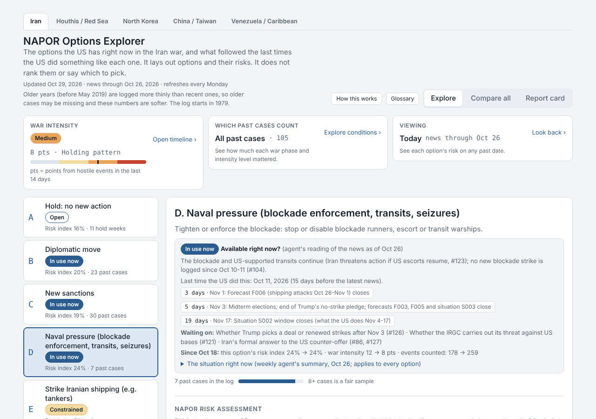

# NAPOR: Options Explorer

An options explorer for the risks behind US national security decisions, built from 450+ events across
5 active conflicts and information pulled from 500+ credible sources.

 

NAPOR was inspired by how the Maven Smart System organizes information: it pulls reports from many
sources into one picture so a decision-maker can see what is happening and what their options are.
NAPOR follows the same idea on a smaller scale, using only public news. NAPOR is simply an acronym for
the mechanism itself: **Notebook, Arrows, Patterns, Organization, and Report.**

- **Notebook** – every event written down once, with an ID, credible sources and a 0–1 credibility score.
- **Arrows** – links from a US move to the replies that followed it.
- **Patterns** – what usually follows what, counted as "x of n past cases".
- **Organization** – war phases, intensity, duplicate checks and a change log.
- **Report** – predictions locked before the outcome, then graded.

Originally I set out to build a model that predicts the future. I switched it to an **Options
Explorer**, because the more useful question is "what happened the last times the US did this?"
The underlying problem was quantifying risk. Risk is perspective based and can be too broad, so
quantifying it requires a specific definition, and any definition is controversial. Looking at past
conflicts, NAPOR found the same five kinds of risk across many previous cases:

1. **People** – someone was hurt, by the US action or by the reply.
2. **Escalation** – the other side struck back within days.
3. **Military** – the reply used missiles, rockets or drones.
4. **Economic** – attacks on shipping or other economic damage went up afterward.
5. **Political** – no talks, meetings or deals followed within 14 days.

The page lays out each option and its risks. **It does not pick the "best" option.** That is the
decision-maker's job.

## How accurate is it?

NAPOR is graded with the Brier score, which measures how close a probability was to what actually
happened. A score of 0 is perfect, and 0.25 is what you get by always guessing 50%, basically a coin
flip, so anything under 0.25 means the past cases are telling us something real. To test this fairly,
NAPOR replays history in order and only uses the cases that were known at that time, so it can never
peek at the future. On the Iran tab, the risk numbers score about **0.17**, which beats a coin flip.
However, when the model only learns from the years before the 2026 war and is graded on the war itself,
it scores about **0.27**, slightly worse than a coin flip. Therefore the past is a useful guide, but a
new war does not always follow old patterns, and I show both numbers on the page's Report Card.

## Why Iran first

The US–Iran conflict was first because it is ongoing and has a long record of past cases. In terms of
US conflicts, Iran is one of the most trending headlines, so it made a good prototype: a current
conflict that has gone on long enough to have a significant number of past cases. Once the model
worked for Iran, it was easy to copy it and apply it to other theaters: the Houthis / Red Sea, North
Korea, China / Taiwan, and Venezuela / Caribbean.

## How I built this

This was my first project where I used AI to build a system for me. I wanted to learn how well AI
follows instructions and learns from failures. The process took a lot of failure (wrong news sources,
wrong ways of defining risk, numbers that did not hold up in testing), and I wanted to see how well AI
could learn from those failures and keep improving the model.

**What I designed:**
- The source rules: which outlets count as credible and which only count as labelled claims.
- The core rule that the page presents options and their risk, and never ranks them or picks one.
- What counts as risk: the five categories (AI helped me spot patterns in the past cases), and the idea
  that risk is defined by what happened in past cases.
- The NAPOR structure itself, modeled on how the Maven Smart System organizes information.
- Connecting the weekly news scan to the live page, so it updates on its own every Monday.
- The approval rule: the AI can suggest changes to the model, but no rule changes without my OK.
- The multi-AI workflow described below.
- The credibility rule: after finding events that were not linked to a credible source, I made it a rule
  that every event must link to at least one credible source, or it does not count. Every event in the
  numbers now links to a credible source.

**What Claude did:** Claude helped heavily with researching the past cases, since AI is, in my opinion,
the fastest and best information processor. It looked into each past case, pulled out the relevant
information, and sorted it into the five categories. It also wrote most of the code, built the
interactive page, ran the backtests that check whether the numbers hold up, and runs the weekly news scan.

## Next steps

- **Better news sources.** Public news can be incomplete, so access to better-quality sources would mean
  more accurate data and more past cases to find patterns in.
- **More theaters.** Apply the model to more US interactions, so every one has its own tab.
- **More frequent scans.** Move the weekly scan to twice a week or daily (currently limited by usage).
- **AI improving the model.** Keep using a team of AI models to find ways to improve it. Opus (max effort)
  is the "mastermind" that comes up with ideas and does the final review, Opus (medium effort) is the
  "organizer" that turns them into instructions and checks the work, and Sonnet models are the "workers"
  that do the research and coding.

## Intended use and limits

**Intended use.** NAPOR is meant to give an accurate picture of the risk behind the current options the
US has with different actors in different conflicts. For each option it reports the likely outcomes,
built from patterns in similar past cases. Other uses:
- A starting point for students and analysts studying how US moves and adversary replies have played out.
- A way to check a claim like "every time the US strikes, they hit back" against the actual record.
- A record over time: every week is saved, so you can look back at what the options and risks looked
  like on any past date.

**Limits.**
- The news is public, so it may be more limited or censored than the information that people with
  higher clearance have.
- The risk percentage is built from 5 categories, and there may be other kinds of risk that we don't
  see from our perspective.
- The scanner runs once a week, so updates can be delayed by up to a week.
- Many options rest on a small number of past cases, so the numbers should be read as hints, not facts.
- "After" is not "because of": a reply that followed a US move was not always caused by it.
- Older years are logged less densely than recent ones, so early history is less complete.

## How it works

Every event is written down once with credible sources, linked to what followed it, and counted into
the five risk categories as "x of n past cases" with a margin of error. The page never ranks options,
and every number is backtested.
- [`docs/METHODOLOGY.md`](docs/METHODOLOGY.md) – how risk is defined, counted and tested, step by step.
- [`docs/ARCHITECTURE.md`](docs/ARCHITECTURE.md) – a diagram of how the pieces connect and a map of the folders.
- [`docs/SOURCE_STANDARD.md`](docs/SOURCE_STANDARD.md) – which news sources count as credible.

Run everything with one command: `cd napor && python3 weekly_build.py` (PASS/FAIL checklist).

## Theaters

- **Iran** (2019 on, mostly the 2026 war): the main tab, with forecasts and a decision log.
- **Houthis / Red Sea**: US moves and Houthi replies. Caveat: 2024 was continuous fighting, so few cases count, and the 2025–26 log is thin.
- **North Korea**: US/South Korea moves and DPRK launches. Caveat: the launch log is a sample; economic harm is not measured.
- **China / Taiwan**: Taiwan Strait and South China Sea. Caveat: small n; Option A has no cases.
- **Venezuela / Caribbean**: US moves toward Venezuela and the boat-strike campaign, and Venezuelan or armed-group replies. Caveat: only 8 of about 70 boat strikes are logged one by one, most Venezuelan replies are statements (not counted as escalation), option G has 1 case, and hold weeks may hide unlogged strikes.

Each non-Iran theater is a package in `napor/theaters/<id>/`; data goes to `explorer/data/<id>.json`.

## Data notes (Iran)

- Small samples: options rest on 3–16 past cases (2019 onward; pre-war record in `napor/prewar.py`).
- Hold weeks (option A) are mostly quiet weeks with few logged events; they show what the log records, and an unlogged event would change them.
- Fitted on 2019-2025 only, every method does worse on 2026 cases than always saying 50% (Report card): the pre-war record alone does not predict this war well.
- Before 2026 most replies came from Iran-backed militias; they count as replies and are labelled "proxy".
- Pre-war years are logged less densely than 2026, so war intensity before 2026 is understated.
- The phase boundaries were drawn with hindsight.
- July's nightly US strikes and pre-September shipping attacks are under-logged.

See `AGENT.md` for the rules the weekly maintenance agent follows.
