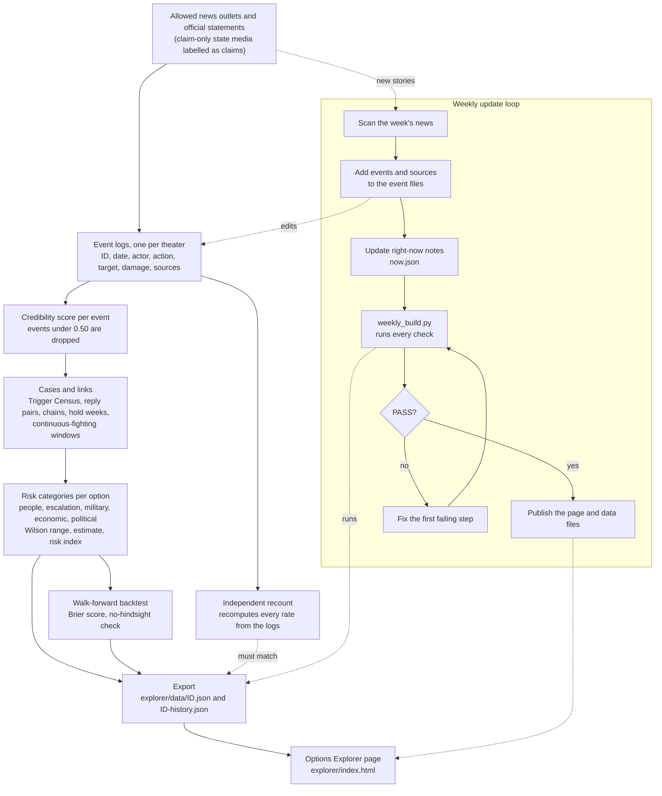

# NAPOR: Risk Assessment - architecture

How data moves through the repository, and where each part lives. The rules behind each step are in
[METHODOLOGY.md](METHODOLOGY.md). The rules for sources are in [SOURCE_STANDARD.md](SOURCE_STANDARD.md).

## Data flow

Reading the diagram:

- The solid path is the build: news becomes logged events, events are scored, scored events become cases,
  cases become the five risk numbers per option, and the export writes what the page reads. The page never
  hard-codes a number or an option letter.
- The backtest scores the same method against its own history and writes its result into the export. The
  independent recount (`napor/verify_explorer.py`, `napor/theaters/common.py` class `Recount`) does not use
  the case builder, so a mistake there cannot hide; the export step fails if the two disagree.
- The weekly loop adds new events, then runs one command, `cd napor && python3 weekly_build.py`. Only a PASS
  is published (steps in [AGENT.md](../AGENT.md)).
- `tests/` (pytest, also run by `.github/workflows/tests.yml` on every push and pull request) check the
  committed event logs and exported data without writing any file.

## Repository layout

Paths below are used by the weekly update. Do not move or rename them without updating `AGENT.md` and
`napor/weekly_build.py`.

| Path | Purpose |
|---|---|
| `README.md` | Project overview, written by the owner |
| `AGENT.md` | Steps and rules for the weekly update, including what must not be changed |
| `CHANGELOG.md` | Dated log of every change to data and model rules, with the reason |
| `requirements.txt` | Python packages: `openpyxl`, `pytest` |
| `index.html` | Redirect to `explorer/` |
| `.nojekyll`, `.gitignore`, `LICENSE` | Hosting, ignore rules, license |
| `.github/workflows/tests.yml` | Workflow "tests": installs requirements on Python 3.11 and runs pytest |
| **`docs/`** | |
| `docs/SOURCE_STANDARD.md` | Which outlets may be cited, which are claim-only, which are banned |
| `docs/METHODOLOGY.md` | Technical reference for the numbers |
| `docs/ARCHITECTURE.md` | This file |
| `docs/THEATERS.md` | Research memo on the theaters built and candidates for later tabs |
| `docs/screenshot.png` | Image used by the README |
| **`explorer/`** (the page and its data) | |
| `explorer/index.html` | The Options Explorer page; reads the JSON files below |
| `explorer/theaters.json` | Registry of tabs: id, name, status, data file, as-of date |
| `explorer/data/<id>.json` | Page data for one theater: options, cases, sources, report card, history |
| `explorer/data/<id>-history.json` | Weekly snapshots of each option's index, kept for "since last update" |
| `explorer/data.json` | Fallback copy of the Iran data |
| `explorer/verify-<id>.json`, `verify.json` | Independent recount output (Iran is `verify.json`); checks, not page files |
| **`napor/`** (engine and Iran data) | |
| `napor/data.py` | Iran 2026 event log (IDs 1-128), pairs, Trigger Census, merged duplicates, kind of act |
| `napor/prewar.py` | Iran events from May 2019 to Feb 2026 (IDs 201-265), windows, phases |
| `napor/prewar_early.py` | Iran events from Nov 1979 to May 2019 (IDs 300-376), the 1987-88 Tanker War window, early phases |
| `napor/audit_sources.py` | Source citations (outlet, headline, date, URL) for the Iran events |
| `napor/napor_ids.py` | Report IDs, credibility scoring, the 0.50 cut, intake of new stories |
| `napor/resolver.py`, `napor/matcher.py` | Decide whether a new story is a new event or a known one |
| `napor/napor_threads.py` | Phases and chains (back-and-forth links) for Iran |
| `napor/napor_intensity.py` | 14-day intensity points and bands |
| `napor/napor_options.py` | Iran options A-H, talk words, shipping and strike tests, risk lines |
| `napor/hold_weeks.py` | Iran option A: hold weeks and the hand-set "people hurt" flags |
| `napor/napor_cases.py` | The five categories, closing windows, recency weights: one definition for export and backtest |
| `napor/napor_context.py` | Ceasefires and pledges that limit which options are open on a past date |
| `napor/backtest_risk.py` | Walk-forward backtest of the page's numbers; writes `napor/backtest_risk.json` |
| `napor/backtest.py` | Earlier backtest of reply timing (Trigger Census and pairs) |
| `napor/export_explorer.py` | Builds and writes the Iran page data and runs the self-checks; shared risk-index helpers |
| `napor/verify_explorer.py` | Independent recount for Iran |
| `napor/weekly_build.py` | One command that runs every check and prints PASS or FAIL |
| `napor/build.py`, `napor/NAPOR_iran_war.xlsx` | Builds the Iran workbook (events, census, options) |
| `napor/napor_now.json` | Iran "right now" notes: status of each option, key dates, what is pending |
| `napor/napor_forecasts.py`, `.json` | Log of forecasts locked before the outcome and graded after (Iran) |
| `napor/napor_decisions.py`, `.json` | Log of which option the US chose in each open situation (Iran) |
| `napor/napor_review_queue.json` | Stories waiting for a person to decide: duplicate or new |
| **`napor/theaters/`** (one package per conflict) | |
| `napor/theaters/__init__.py` | Reads and updates `explorer/theaters.json` |
| `napor/theaters/common.py` | Shared engine: `Theater` (cases), `Backtest`, `Export`, `Recount` |
| `napor/theaters/iran/` | Thin wrappers that point the shared scripts at the Iran modules above |
| `napor/theaters/<id>/events*.py` | Event log for houthis, northkorea, china, venezuela (read only for the engine) |
| `napor/theaters/<id>/config.py` | Wording, options A-H, flags, claim-only outlets, rules, hold weeks, closing windows |
| `napor/theaters/<id>/cases.py, export.py, verify.py, backtest.py` | A few lines each; call the shared classes |
| `napor/theaters/<id>/now.json` | "Right now" notes for that theater |
| `napor/theaters/<id>/backtest_risk.json` | Backtest result for that theater |
| `napor/theaters/houthis/events_early.py`, `events_late.py` | Houthi log in two files (Sep 2014 on) |
| `napor/theaters/northkorea/events_pre2017.py` | North Korea events from Mar 1993 to Aug 2017 (IDs 2500-2587); `events.py` runs from Aug 31, 2017 |
| `napor/theaters/china/events_pre2019.py`, `napor/theaters/venezuela/events_pre2019.py` | China (May 1995 - Dec 2018, IDs 3500-3566) and Venezuela (Feb 1999 - Jan 2019, IDs 4500-4568) earlier events; `events.py` runs from Jan 2019 |
| `napor/theaters/northkorea/notes.py`, `china/notes.py`, `venezuela/notes.py` | Analyst notes shown on the page |
| `napor/theaters/venezuela/acts.py`, `rules.py` | Word tests for hostile acts and the stricter escalation rule |
| **`tests/`** | |
| `tests/conftest.py` | Puts `napor/` on the import path; helper to load exported data |
| `tests/test_stats.py` | Wilson ranges, m=2 estimate, Brier score, equal-weight index |
| `tests/test_theaters.py` | Per theater: export keys and A-H order, sources, 0.50 cut, no-hindsight check, recount |
| `tests/test_resolver.py` | Headline-matching test (moved from `napor/`; also run by `weekly_build.py`) |

## Adding a theater

Copy a finished package such as `napor/theaters/northkorea/`, write `config.py` and the event file in the next free
ID block, add a `now.json`, register it in `explorer/theaters.json`, and run `weekly_build.py` until it passes. The
tests pick up the new theater from the registry. Full steps are in `AGENT.md`.
